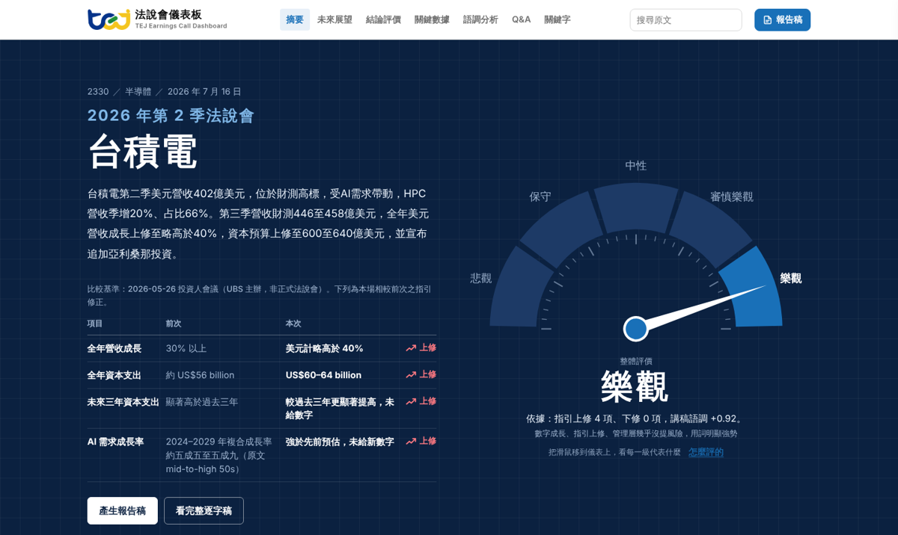

# 法說會儀表板 Earnings Call Dashboard

一個 Claude skill：上傳法說會逐字稿，產生每個數字都查得到出處的互動儀表板；多場放在一起，就能看同一家公司的說法怎麼變。台灣經濟新報（TEJ）實習期間的專案。

**線上網站：** https://你的帳號.github.io/earnings-call-dashboard/



## 網站上有什麼

- **13 家公司、14 場法說會**：左側依「公司 → 年份 → 場次」切換
- **跨季追蹤**：點公司，看同一項指引在各場的說法與語調趨勢。例如台積電全年營收成長由略高於 40% 上修至約 44%
- **每場都是完整的互動儀表板**：這場改變了什麼、每個數字的原句、三種可直接複製的報告稿、評價與語調怎麼算的

## 它怎麼做到一致

AI 只負責讀懂與寫作；讀檔、分數、次數、版型、檢查全部交給程式。產出之後由檢查程式逐條核對，例如每個數字都要出現在原句裡、報告稿的數字要有出處、摘要 80 到 120 字，沒通過就退回重寫。

| 測試 | 結果 |
|---|---|
| 全庫掃描：TEJ 資料庫 484 場 | 0 場當掉 |
| 回歸測試：16 個案例（英文、中文、極短、極長、PDF、金控、航運⋯⋯） | 16／16 通過 |
| 反向測試：故意埋 11 種錯誤 | 11／11 擋下 |
| 換模型：Sonnet 跑同一場 | 通過，並據此補了三條規則 |

想看 skill 裡面寫了什麼，打開 [skill 導覽](docs/skill導覽.html)。

## 開發過程

一輪一輪討論出來的，每輪的要求、決定與理由都有紀錄：

- [需求演進與決策紀錄](docs/02_需求演進與決策紀錄.md)：11/3–11/11，從找參考作品到做成 skill
- [開發紀錄](docs/03_開發紀錄_互動版_final_20261111.md)：11/11–11/13，互動版、測試、第二階段與網站
- [自我審查](docs/自我審查_final_20261111.md)：對照 TEJ 簡報逐項檢查
- [案例集](cases/README.md)：16 個測試案例與找到的問題

## 檔案

```
index.html、index.js、data/     網站（GitHub Pages 首頁就是這裡）
integrate.py                    掃描 data/、產生 index.js
.github/workflows/pages.yml     推送後自動重建並發布網站
skill/                          skill 原始碼
dist/                           打包好的 .skill，可直接安裝到 Claude
cases/                          16 個測試案例（不含逐字稿）
tools/                          全庫掃描、回歸測試、反向測試、比對工具
docs/                           開發紀錄、自我審查、skill 導覽、截圖
```

## 新增一場

1. 用 skill 產生公開版儀表板（`render_motion.py --public`）
2. 在 GitHub 網頁進入 `data/` → Add file → Upload files 上傳；不要了就刪掉
3. 約一分鐘後網站自動更新

## 資料與聲明

逐字稿來源為 TEJ 逐字稿資料庫。網站使用公開版儀表板，只保留各模組引用的原句，不附完整逐字稿。內容由 AI 依逐字稿整理，僅供參考，不構成投資建議。
