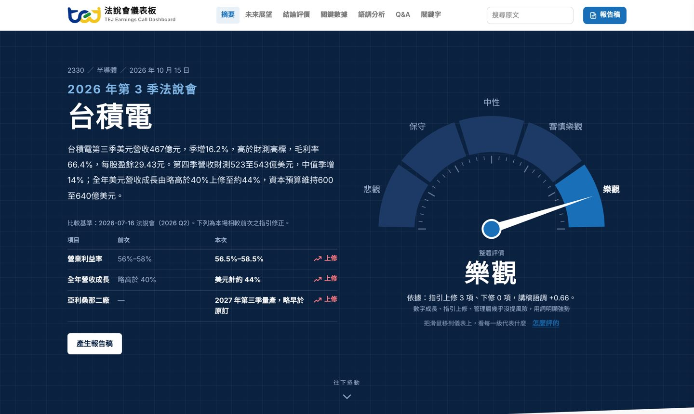
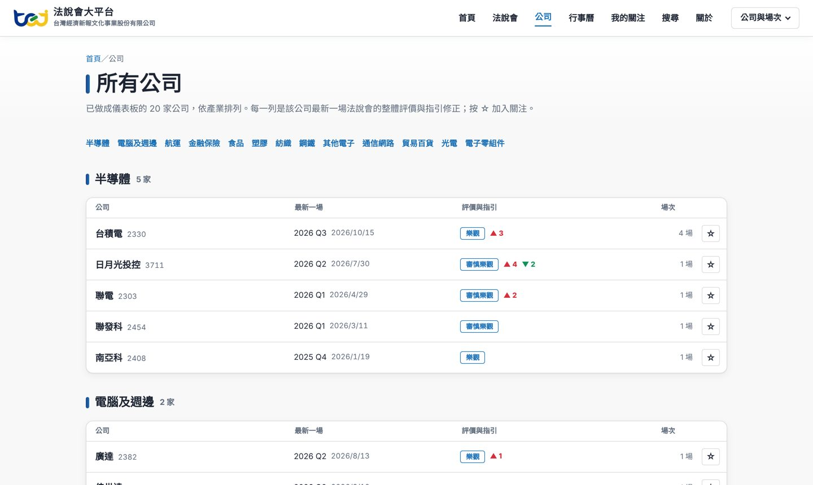
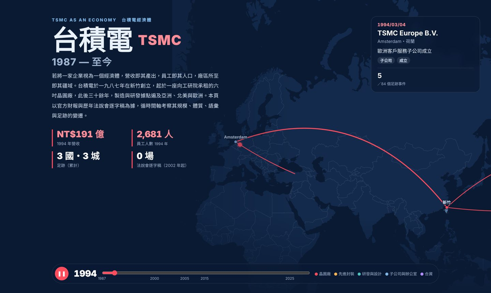

# 法說會大平台 Earnings Call Platform

[](https://github.com/yiyu0501/earnings-call-dashboard/actions/workflows/pages.yml)
[](https://github.com/yiyu0501/earnings-call-dashboard/actions/workflows/ci.yml)
[](https://github.com/yiyu0501/earnings-call-dashboard/commits/main)

彙整臺灣上市櫃公司法人說明會的日程與逐字稿，整理為可檢索、可比較的互動儀表板；每一項數據都附有逐字稿原句，可以回溯出處。

**[線上網站](https://yiyu0501.github.io/earnings-call-dashboard/)**　·　[一頁簡介](docs/一頁簡介.pdf)　·　[操作手冊](docs/操作手冊.md)　·　[回報問題](https://github.com/yiyu0501/earnings-call-dashboard/issues/new/choose)


| 單場儀表板 | 所有公司 | 台積電經濟體 |
|---|---|---|
|  |  |  |

本專案為台灣經濟新報（TEJ）實習期間之研究專案。儀表板由一套 Claude skill 產生，網站為純靜態頁面，部署於 GitHub Pages。

---

## 目錄

- [主要功能](#主要功能)
- [運作方式](#運作方式)
- [更新流程](#更新流程)
- [品質驗證](#品質驗證)
- [專案結構](#專案結構)
- [使用方式](#使用方式)
- [資料來源與聲明](#資料來源與聲明)
- [第三方程式與資料](#第三方程式與資料)
- [專案狀態與路線圖](#專案狀態與路線圖)
- [參與與回饋](#參與與回饋)
- [相關文件](#相關文件)
- [維護](#維護)

---

## 主要功能

| 功能 | 說明 |
|---|---|
| 首頁 | 公司與關鍵字搜尋（輸入時自動提示）、依產業瀏覽、最新法說會、法說會行事曆；主視覺為可互動的 3D 長條圖 |
| 法說會行事曆 | 收錄 TEJ 逐字稿資料庫 252 家公司、482 場法說會的日程；預設顯示 19 個產業的指標公司，其他公司可在搜尋後加入關注 |
| 單場儀表板 | 20 家公司、23 場。包含摘要與整體評價、財務指引與上下修、關鍵數據、問答整理、語調分析、關鍵詞，以及三種可直接複製的報告稿 |
| 跨季追蹤 | 公司頁對照同一項指引在各場的說法與語調走勢 |
| 公司目錄與我的關注 | 依產業列出所有公司的最新評價；關注的公司整理出最新一場與下一場 |
| 意見回饋、使用條款 | 回饋頁可帶入目前頁面，送到 GitHub、Email 或表單；使用條款含隱私權說明 |
| 搜尋引擎與分享 | 每家公司有靜態頁 `c/<代號>/`（附摘要、指引、原句），並有 `sitemap.xml`；分享到 LINE 等會顯示預覽卡 |
| 焦點專區：台積電 | 以台積電 1987 年至今的官方財報與 2002 年以來 98 場法說會逐字稿為據，提供建廠足跡地圖、營收與毛利率走勢、法說會議會席次圖、年度語彙與詞頻對照 |

---

## 運作方式

```
法說會逐字稿（TEJ xlsx／PDF／Word）
   │  extract_text.py     讀檔、切段、辨識發言人、刪除重複收錄、找出上一場
   ▼
transcript.json
   │  Claude + skill      依固定規則撰寫摘要、指引、關鍵數據與問答，每項附原句
   │  tone_score.py       語調分數
   │  keyword_count.py    關鍵詞次數
   │  render_motion.py    產生單場儀表板（網站使用 --public 公開版）
   │  check_output.py     逐條核對原句、數字、字數與格式；未通過即退回重寫
   ▼
data/<公司>_<日期>.html
   │  integrate.py --site 彙整各場重點，產生 index.js
   ▼
index.html ＋ index.js ＋ universe.js  →  GitHub Actions 檢查後發布
```

設計原則是：凡能由程式完成的步驟（讀檔、計分、計數、版型、檢查）皆不交由 AI，AI 只負責閱讀與撰寫，使不同場次、不同操作者的產出維持一致品質。

---

## 更新流程

| 什麼時候 | 誰來做 | 做什麼 |
|---|---|---|
| 每次推送到 `main` | GitHub Actions（自動） | 檢查 `data/` 是否夾帶完整逐字稿（有就停止發布）→ 重建 `index.js` → 產生各公司靜態頁 `c/<代號>/` 與 `sitemap.xml` → 發布到 GitHub Pages，約 1–2 分鐘 |
| 有新的法說會 | 人工（Claude） | 用 skill 產生儀表板、輸出公開版，放進 `data/` 後推送；也可以直接在 GitHub 網頁上傳到 `data/` |
| 每季財報季 | 人工 | 從 TEJ 逐字稿資料庫匯出 xlsx，執行 `tools/build_universe.py` 更新行事曆 |
| 每月 | Dependabot（自動） | 檢查 GitHub Actions 是否有新版本，有的話開 PR |

儀表板目前在 Claude 裡由人工觸發產生。若要在資料庫出現新逐字稿時全自動產生，需要另設伺服器，以 Claude API 載入本 skill 產生 `dashboard.json`，經 `check_output.py` 檢查通過後再推送；做法見[交接說明](docs/交接說明.md)第 6 節。

---

## 品質驗證

| 測試 | 結果 |
|---|---|
| 全庫掃描：TEJ 逐字稿資料庫 484 場 | 0 場失敗 |
| 回歸測試：16 個案例（英文、中文、極短、極長、PDF、金控、航運等） | 16／16 通過 |
| 反向測試：刻意植入 11 種錯誤 | 11／11 攔截 |
| 更換模型：以 Sonnet 產生同一場 | 通過，並據此補充三條規則 |

---

## 專案結構

```
index.html               網站（由 skill/…/assets/integrated_template.html 複製）
index.js                 各場重點彙整（integrate.py 產生）
universe.js              行事曆資料（tools/build_universe.py 產生）
data/                    各場公開版儀表板
tsmc/index.html          台積電焦點專區
vendor/three-lite.js     首頁 3D 主視覺使用的 three.js 精簡版
integrate.py             掃描 data/、產生 index.js
c/                       各公司靜態頁（tools/build_seo.py 產生）
sitemap.xml              網站地圖（tools/build_seo.py 產生）
archive/                 已下架的儀表板
skill/                   Claude skill 原始碼（SKILL.md、規則文件、程式、模板）
dist/                    打包好的 .skill，可直接安裝於 Claude
tools/                   行事曆產生器、台積電專區重建工具、全庫掃描、回歸測試、網站測試
cases/                   16 個測試案例（不含逐字稿原文）
docs/                    交接記憶檔、操作手冊、一頁簡介、交接說明、開發紀錄、截圖；歷史文件/ 為早期規劃與審查
.github/workflows/       pages.yml 推送後檢查並發布；ci.yml 每個 Pull Request 的檢查
.github/ISSUE_TEMPLATE/  資料錯誤、網站問題、功能建議的回報範本
```

---

## 使用方式

### 本機預覽

```bash
python -m http.server 8000
# 瀏覽 http://localhost:8000/
```

### 新增一場法說會

1. 依 `skill/earnings-call-dashboard/SKILL.md` 產生儀表板，並輸出公開版：
   ```bash
   python skill/earnings-call-dashboard/scripts/render_motion.py WORK/dashboard.json \
       --tone WORK/tone.json --keywords WORK/keywords.json --transcript WORK/transcript.json \
       --public --outdir WORK/out_public
   ```
2. 加入網站並檢查：
   ```bash
   python integrate.py --target . --site --add WORK/out_public
   python integrate.py --target . --site --check
   ```
3. 推送後約一分鐘，GitHub Pages 自動更新。

### 更新行事曆

```bash
python tools/build_universe.py <TEJ 逐字稿 xlsx> universe.js
```

產業分類與各產業指標公司定義於 `tools/build_universe.py` 的 `INDUSTRIES`。

### 調整版面

首頁區塊順序、焦點公司與專區頁面路徑等設定，集中在 `integrated_template.html` 開頭的 `SITE` 物件。修改模板後複製為 `index.html`。詳見 [交接說明](docs/交接說明.md)。

### 重建台積電專區

資料與步驟見 [`tools/tsmc_economy/README.md`](tools/tsmc_economy/README.md)。

---

## 資料來源與聲明

- 法說會逐字稿：TEJ 逐字稿資料庫。
- 台積電專區：台積電投資人關係網站之歷年法說會逐字稿、季度報告與年報。
- 網站使用公開版儀表板，僅保留各模組引用的原句，不附完整逐字稿；本儲存庫亦不包含逐字稿原文。
- 內容經 AI 整理及程式核對，仍可能存在判斷差異，請以原始逐字稿與公司公告為準。
- 本站內容僅供研究參考，不構成任何投資建議。

---

## 第三方程式與資料

| 項目 | 用途 | 授權 |
|---|---|---|
| [three.js](https://threejs.org/) | 首頁 3D 主視覺（`vendor/three-lite.js` 為依需求打包的精簡版） | MIT，見 `vendor/LICENSE-three.txt` |
| [world-atlas](https://github.com/topojson/world-atlas)（Natural Earth） | 台積電專區世界地圖 | ISC；地圖資料為公有領域 |
| [taiwan-atlas](https://github.com/dkaoster/taiwan-atlas) | 台積電專區臺灣縣市界線 | MIT；資料源自內政部村里界圖（政府資料開放平臺） |
| d3-geo、topojson-client、topojson-simplify | 建置時產生地圖路徑（不隨網站發布） | ISC |

---

## 專案狀態與路線圖

**目前版本**：20 家公司、23 場儀表板；行事曆 252 家、482 場；台積電經濟體涵蓋 1987 年至今。網站功能已完整，2026-12-04 展示後發布 v1.0.0。

| 階段 | 項目 | 狀態 |
|---|---|---|
| 已完成 | 單場儀表板 skill、法說會大平台網站、台積電經濟體、所有公司與我的關注、搜尋直達段落、各公司靜態頁與網站地圖、意見回饋與使用條款 | ✅ |
| 下一步 | 流量統計啟用、Google Search Console 收錄 | 待設定 |
| 需接 TEJ 資料 | 市場共識、以 IFRS 財報統一指標後的公司並排比較與同產業指標對照 | 規劃中 |
| 需要後端 | 新逐字稿出現時自動產生儀表板、帳號與通知 | 規劃中 |

---

## 參與與回饋

- 數字或原句有誤、網站問題、功能建議：請[開 Issue](https://github.com/yiyu0501/earnings-call-dashboard/issues/new/choose)，選擇對應的範本；沒有 GitHub 帳號可以使用網站的[意見回饋](https://yiyu0501.github.io/earnings-call-dashboard/#feedback)。
- 開發流程、分支與 commit 規範：見 [CONTRIBUTING.md](CONTRIBUTING.md)。
- 資安問題請依 [SECURITY.md](SECURITY.md) 私下回報。

---

## 相關文件

完整索引見 [docs/README.md](docs/README.md)。

| 想知道 | 文件 |
|---|---|
| 專案目的、做法與成果 | [一頁簡介（PDF）](docs/一頁簡介.pdf) |
| 新增法說會、更新行事曆、發布與維護 | [操作手冊](docs/操作手冊.md) |
| 網站架構與後續發展 | [交接說明](docs/交接說明.md) |
| 全貌、重要決定與理由、目前狀態 | [專案交接記憶檔](docs/00_專案交接記憶檔.md) |
| 每一輪的需求、決定與驗證 | [開發紀錄](docs/03_開發紀錄_互動版_final_20261111.md) |
| skill 每個檔案的內容 | [Skill 導覽](docs/skill導覽.html) |
| 測試案例 | [案例集](cases/README.md) |
| 網頁開發流程與 UI／UX 審查方法 | [網頁專案工作方法](docs/網頁專案工作方法.md) |
| 版本變更 | [CHANGELOG](CHANGELOG.md) |


---

## 維護

| 角色 | 負責 |
|---|---|
| [@yiyu0501](https://github.com/yiyu0501) | 專案維護者：網站、skill、資料更新與審查 |
| 台灣經濟新報（TEJ） | 逐字稿資料庫與專案指導 |

---

© 2026 法說會大平台　台灣經濟新報（TEJ）實習專案
